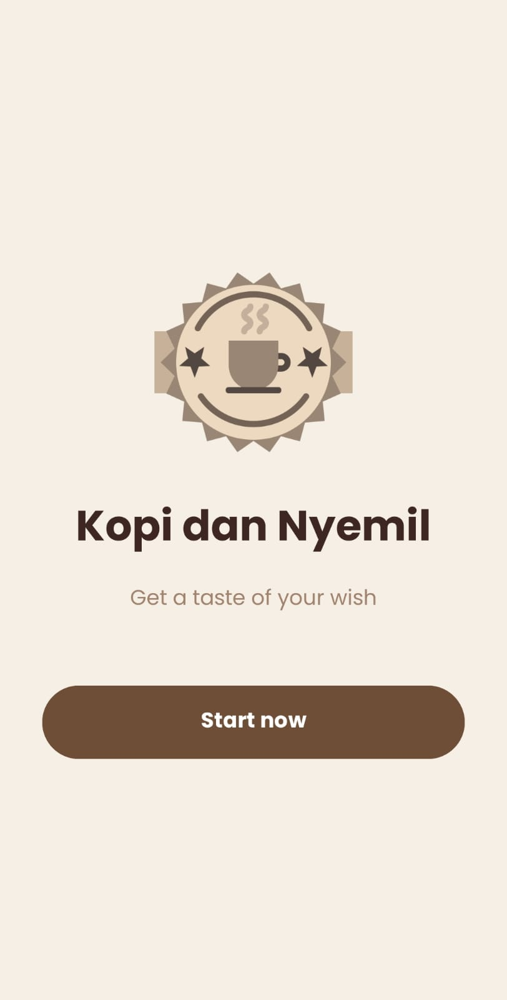
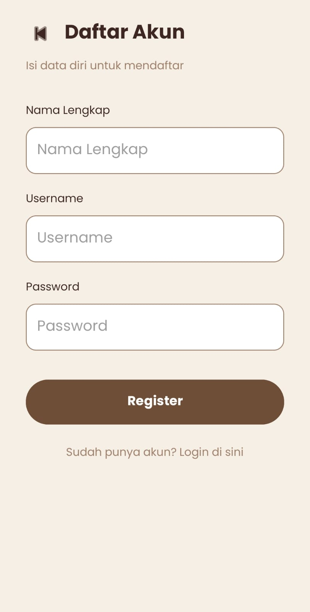
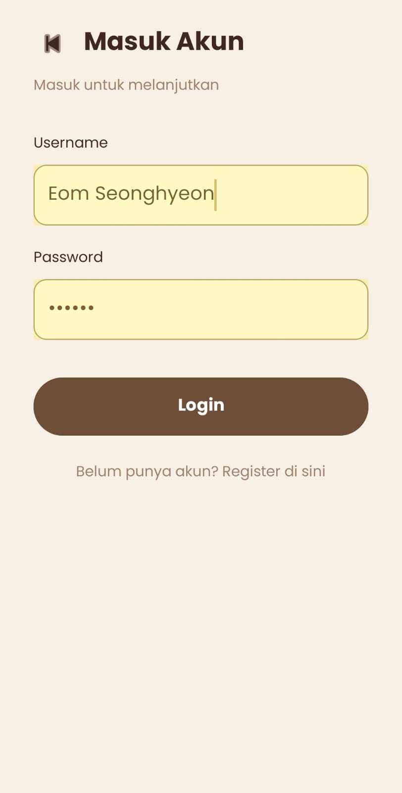
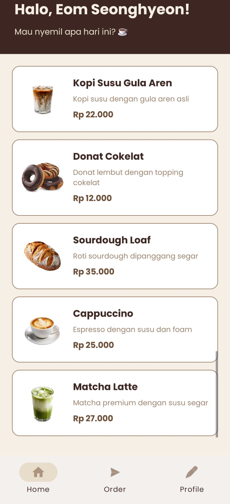
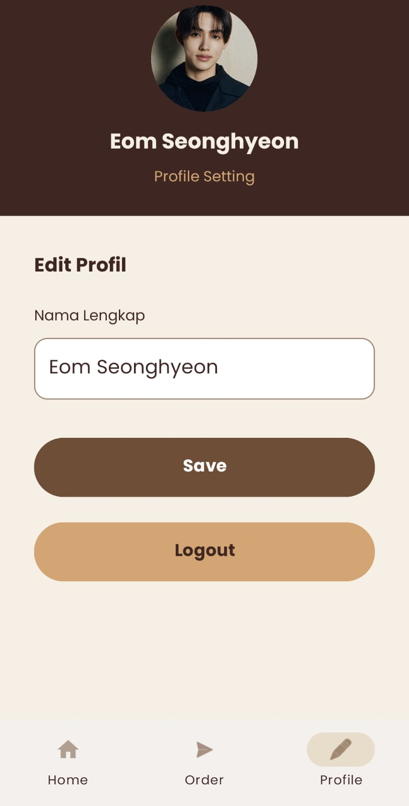
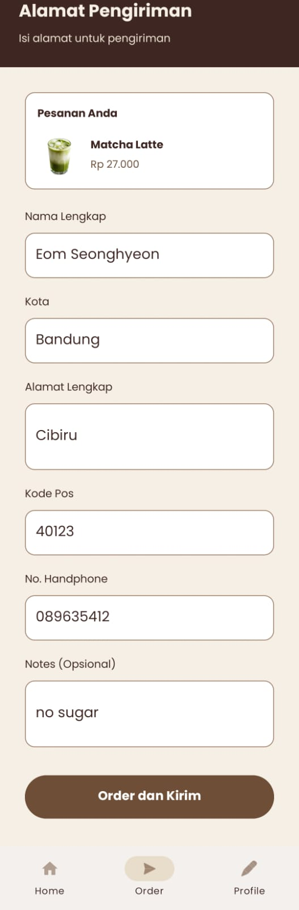
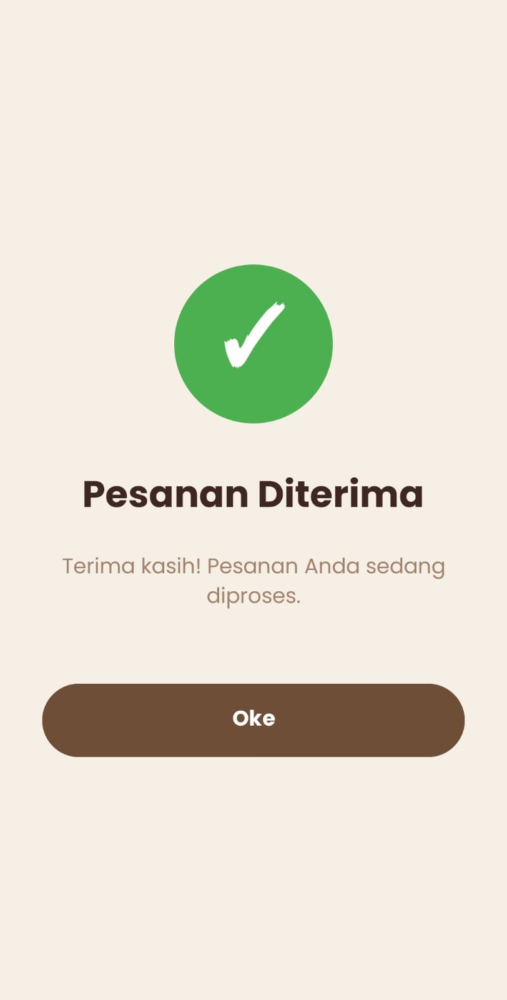

# ☕ Kopi dan Nyemil

Aplikasi mobile pemesanan kopi dan camilan dengan tema warna hangat (coklat & krem). Dibuat untuk memenuhi **Tugas UTS Pemrograman Aplikasi Mobile (PAM)**.

  

---

## 📖 Deskripsi Aplikasi

**Kopi dan Nyemil** adalah aplikasi mobile pemesanan kopi dan camilan dengan tampilan modern dan mudah digunakan. Aplikasi ini mengimplementasikan seluruh halaman sesuai wireframe yang diberikan: Splash/Welcome, Sign Up, Register, Login, Home, Profile, Alamat Pengiriman (Order), dan Konfirmasi Pesanan.

Aplikasi menggunakan **dummy data** (data statis) sehingga tidak memerlukan database. Pengguna dapat memilih menu dari daftar, mengisi alamat pengiriman, dan melihat konfirmasi pesanan.

---

## ✨ Fitur

- 🔐 **Autentikasi** — Register & Login dengan validasi sederhana
- 🏠 **Home Page** — Daftar 5 menu kopi & nyemil dengan gambar
- 🛍️ **Order Page** — Form alamat pengiriman lengkap (nama, kota, alamat, kode pos, no HP, notes)
- 👤 **Profile Page** — Edit nama & logout
- ✅ **Confirmation Page** — Konfirmasi pesanan setelah berhasil order
- 📱 **Bottom Navigation** — Home / Order / Profile dengan pill indicator
- 🎬 **Animasi Slide** — Transisi smooth antar activity
- 🎨 **Tema Warna Kopi** — Coklat, krem, karamel
- 🔤 **Font Custom** — Poppins dari Google Fonts
- 🖼️ **Gambar Menu** — 5 menu kopi & nyemil dengan ilustrasi

---

## 🛠️ Teknologi yang Digunakan

| Kategori | Teknologi |
|----------|----------|
| Bahasa Pemrograman | Kotlin |
| IDE | Android Studio |
| UI Layout | XML (Views tradisional) |
| UI Components | Material Components (BottomNavigationView, Button, dll) |
| List Menu | RecyclerView + Custom Adapter |
| Navigasi | Intent antar Activity |
| Icon | Vector Drawable |
| Font | Poppins (Google Fonts) |
| Min SDK | API 24 (Android 7.0 Nougat) |
| Target SDK | API 37 |

---

## 📋 Halaman (8 Total)

| # | Halaman | File Kotlin | File Layout |
|---|---------|-------------|------------|
| 1 | Welcome / Splash | WelcomeActivity.kt | activity_welcome.xml |
| 2 | Sign Up (pilih Register / Login) | SignUpActivity.kt | activity_sign_up.xml |
| 3 | Register | RegisterActivity.kt | activity_register.xml |
| 4 | Login | LoginActivity.kt | activity_login.xml |
| 5 | Home (list menu) | HomeActivity.kt | activity_home.xml |
| 6 | Profile | ProfileActivity.kt | activity_profile.xml |
| 7 | Order (alamat pengiriman) | OrderActivity.kt | activity_order.xml |
| 8 | Confirmation | ConfirmationActivity.kt | activity_confirmation.xml |

---

## 📦 Struktur Project

```text
KopidanNyemil/
├── app/
│   └── src/main/
│       ├── AndroidManifest.xml
│       ├── java/com/aulia/kopidannyemil/
│       │   ├── WelcomeActivity.kt
│       │   ├── SignUpActivity.kt
│       │   ├── RegisterActivity.kt
│       │   ├── LoginActivity.kt
│       │   ├── HomeActivity.kt
│       │   ├── ProfileActivity.kt
│       │   ├── OrderActivity.kt
│       │   ├── ConfirmationActivity.kt
│       │   ├── Menu.kt
│       │   └── MenuAdapter.kt
│       └── res/
│           ├── anim/           (slide animations)
│           ├── drawable/       (gambar, vector, shape)
│           ├── font/           (Poppins font family)
│           ├── layout/         (semua activity layout)
│           ├── menu/          (bottom_nav_menu)
│           └── values/        (colors, strings, themes)
├── screenshots/               (dokumentasi tampilan)
├── build.gradle.kts
└── settings.gradle.kts
```

---

## 🚀 Cara Menjalankan Aplikasi

### Prasyarat

- **Android Studio** (versi Hedgehog atau lebih baru)
- **JDK 11+**
- **Android SDK** dengan Minimum API 24 (Android 7.0 Nougat)
- **Koneksi Internet** (untuk Gradle sync pertama kali)

### Langkah-langkah

**1. Clone repository**

```bash
git clone https://github.com/auliasdr24/KopidanNyemil.git
```

**2. Buka project di Android Studio**

- Buka Android Studio
- Pilih **File → Open**
- Pilih folder `KopidanNyemil` yang baru di-clone
- Tunggu Gradle sync selesai (mungkin butuh beberapa menit)

**3. Jalankan aplikasi**

- Pilih device (emulator atau HP fisik) di dropdown atas
- Klik tombol **Run** (▶ hijau) atau tekan `Shift + F10`
- Tunggu build selesai, aplikasi akan otomatis terbuka di device

### Login Demo

Aplikasi menggunakan **dummy data** (tanpa database), jadi login bisa pakai username & password apa saja selama tidak kosong.

---

## 🎨 Tema Warna

| Warna | Hex Code | Penggunaan |
|------|---------|------------|
| Coklat Tua | `#3E2723` | Heading, header |
| Coklat Kopi | `#6F4E37` | Primary (tombol, dst) |
| Coklat Soft | `#A0826D` | Teks sekunder |
| Krem | `#F5EFE6` | Background |
| Karamel | `#D4A574` | Aksen |

---

## 📸 Screenshot Tampilan

<table>
  <tr>
    <td width="50%" align="center"><b>Welcome Page</b><br></td>
    <td width="50%" align="center"><b>Sign Up Page</b><br></td>
  </tr>
  <tr>
    <td width="50%" align="center"><b>Register Page</b><br></td>
    <td width="50%" align="center"><b>Login Page</b><br></td>
  </tr>
  <tr>
    <td width="50%" align="center"><b>Home Page</b><br></td>
    <td width="50%" align="center"><b>Profile Page</b><br></td>
  </tr>
  <tr>
    <td width="50%" align="center"><b>Order Page</b><br></td>
    <td width="50%" align="center"><b>Confirmation Page</b><br></td>
  </tr>
</table>

---

## 👤 Author

- **Nama**: Aulia
- **GitHub**: [@auliasdr24](https://github.com/auliasdr24)
- **Mata Kuliah**: Pemrograman Aplikasi Mobile (PAM)
- **Tugas**: UTS

---

## 📜 License

Project ini dibuat untuk tujuan edukasi (tugas kuliah). Bebas dipakai untuk belajar.

Font **Poppins** menggunakan [SIL Open Font License 1.1](https://scripts.sil.org/OFL).
