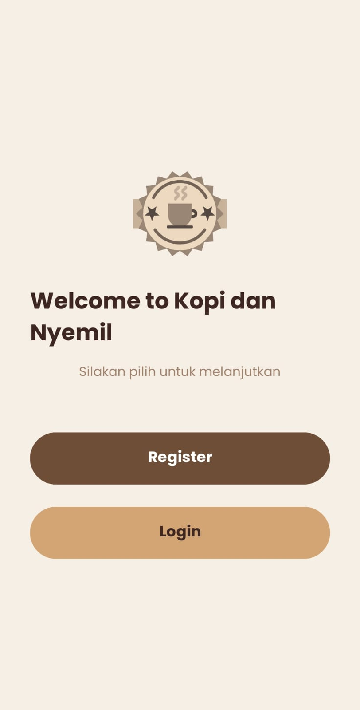
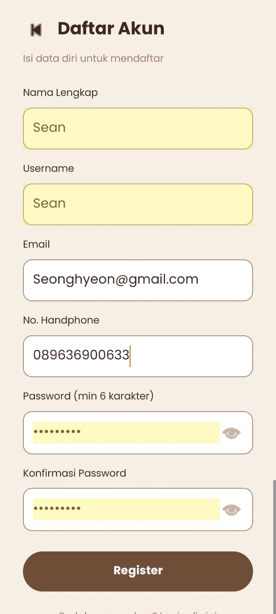
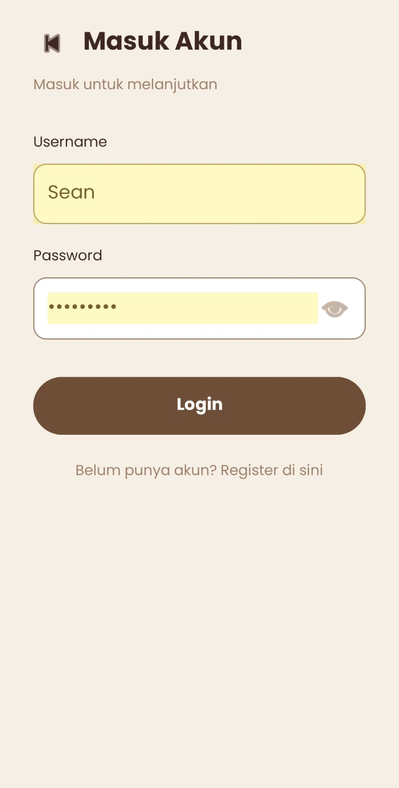
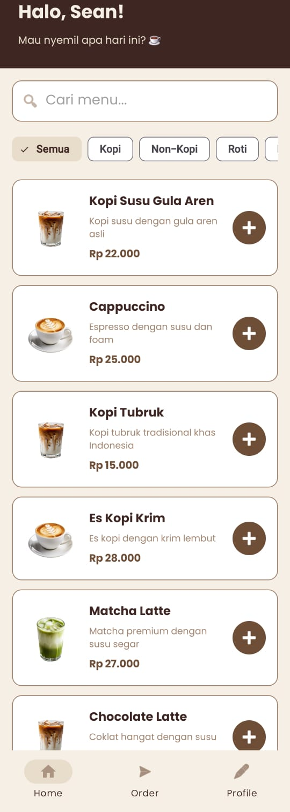
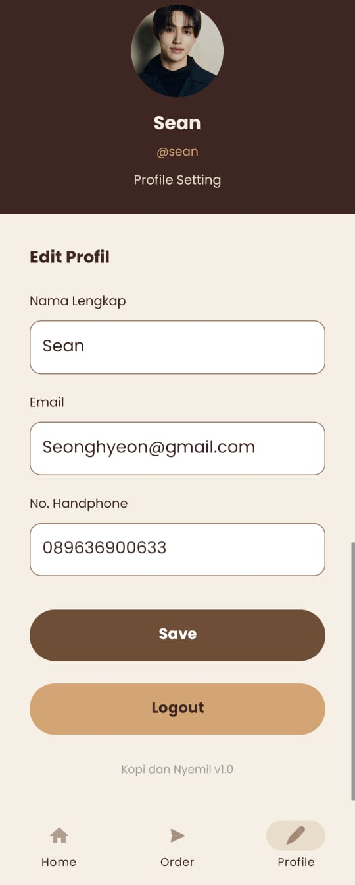
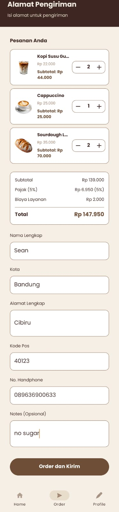
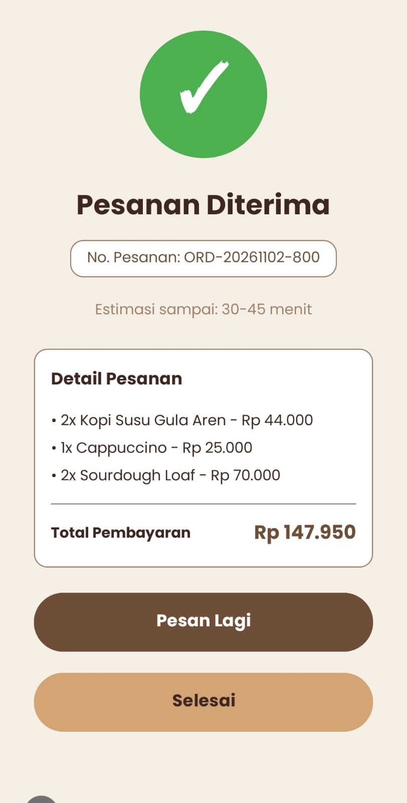

# ☕ Kopi dan Nyemil

Aplikasi mobile pemesanan kopi dan camilan dengan tema warna hangat (coklat & krem). Dibuat untuk memenuhi **Tugas UTS Pemrograman Aplikasi Mobile (PAM)**.

  

---

## 📖 Deskripsi Aplikasi

**Kopi dan Nyemil** adalah aplikasi mobile pemesanan kopi dan camilan dengan tampilan modern dan mudah digunakan. Aplikasi ini mengimplementasikan seluruh halaman sesuai wireframe yang diberikan, yaitu Splash/Welcome, Sign Up, Register, Login, Home, Profile, Alamat Pengiriman (Order), dan Konfirmasi Pesanan.

Aplikasi menggunakan **dummy data** (data statis) sehingga tidak memerlukan database. Pengguna dapat melakukan registrasi, login, memilih menu dari daftar, mencari menu menggunakan fitur search, memfilter kategori, menambahkan menu ke keranjang, mengisi alamat pengiriman, dan melihat konfirmasi pesanan dengan nomor pesanan otomatis.

---

## ✨ Fitur

- 🔐 **Autentikasi** — Register (nama, username, email, no HP, password, dan konfirmasi password) serta Login dengan username/email dan password.
- 👁️ **Show/Hide Password** — Toggle icon mata untuk melihat atau menyembunyikan password pada halaman Login dan Register.
- 🏠 **Home Page** — Menampilkan 12 menu kopi dan camilan dengan fitur search dan filter 6 kategori (Semua, Kopi, Non-Kopi, Roti, Nyemil, Dessert).
- ➕ **Tambah Pesanan** — Tombol tambah untuk memasukkan menu ke keranjang dan menambah jumlah pesanan secara otomatis.
- 🛒 **Keranjang (Cart)** — Menampilkan daftar pesanan dengan tombol tambah/kurang kuantitas, fitur swipe-to-delete, dan total harga otomatis.
- 🛵 **Order Page** — Form alamat pengiriman lengkap (nama, kota, alamat, kode pos, no HP, dan notes).
- 💰 **Perhitungan Harga** — Perhitungan subtotal, pajak 5%, dan biaya layanan sebesar Rp 2.000.
- 👤 **Profile Page** — Menampilkan dan mengedit nama, email, serta no HP dengan validasi. Data otomatis tersinkronisasi dengan informasi registrasi.
- ✅ **Confirmation Page** — Menampilkan nomor pesanan otomatis dengan format ORD-YYYYMMDD-XXX, detail pesanan, dan estimasi waktu sampai.
- 📱 **Bottom Navigation** — Navigasi Home / Order / Profile dengan pill indicator dan badge jumlah item keranjang.
- 🎨 **Tema Warna Kopi** — Menggunakan kombinasi warna coklat, krem, dan karamel.
- 🔤 **Font Custom** — Menggunakan font Poppins dari Google Fonts.
- 🖼️ **Gambar Menu & Avatar Profile** — Menampilkan gambar pada daftar menu dan avatar profil pengguna.
- 💾 **User Session** — Menyimpan data pengguna menggunakan Singleton Object sebagai dummy storage.

---

## 🔄 Alur Aplikasi

### Alur Autentikasi

```text
Welcome
   ↓
Sign Up
   ↓
Register / Login
   ↓
Home
   ↓
Profile
   ↓
Logout
   ↓
Welcome
```

### Alur Pemesanan

```text
Home (12 menu + search + filter kategori)
   ↓
Klik tombol + pada menu
   ↓
Cart terisi (badge muncul di bottom navigation)
   ↓
Buka tab Order
   ↓
Order Page
   ↓
Isi alamat pengiriman
   ↓
Klik "Order dan Kirim"
   ↓
Confirmation Page
   ↓
   ├── Pesan Lagi → Home (cart kosong)
   │
   └── Selesai → Welcome (logout)
```

### Fitur Cart

- Klik tombol **+** di Home untuk menambahkan menu ke keranjang.
- Klik tombol **+** lagi pada menu yang sama untuk menambah quantity.
- Tab Order menampilkan badge merah berisi jumlah item.
- Pada halaman Order, pengguna dapat menambah atau mengurangi quantity.
- Pengguna dapat menghapus item menggunakan fitur swipe-to-delete.
- Total harga dihitung secara otomatis berdasarkan subtotal, pajak, dan biaya layanan.

**Rumus perhitungan total:**

```text
Subtotal       = Total harga semua menu
Pajak          = Subtotal × 5%
Biaya Layanan  = Rp 2.000
Total          = Subtotal + Pajak + Biaya Layanan
```

---

## 🛠️ Teknologi yang Digunakan

| Kategori | Teknologi |
|----------|-----------|
| Bahasa Pemrograman | Kotlin |
| IDE | Android Studio |
| UI Layout | XML (Views tradisional) |
| UI Components | Material Components (BottomNavigationView, Chip, Button, dll) |
| List Menu | RecyclerView + Custom Adapter |
| Navigasi | Intent antar Activity |
| Icon | Vector Drawable |
| Font | Poppins (Google Fonts) |
| Min SDK | API 24 (Android 7.0 Nougat) |
| Target SDK | API 37 |

---

## 📋 Halaman (8 Total)

| # | Halaman | File Kotlin | File Layout |
|---|---------|-------------|-------------|
| 1 | Welcome / Splash | WelcomeActivity.kt | activity_welcome.xml |
| 2 | Sign Up (pilih Register / Login) | SignUpActivity.kt | activity_sign_up.xml |
| 3 | Register (5 field + konfirmasi password) | RegisterActivity.kt | activity_register.xml |
| 4 | Login (username/email + password) | LoginActivity.kt | activity_login.xml |
| 5 | Home (12 menu + search + filter + cart) | HomeActivity.kt | activity_home.xml |
| 6 | Profile (edit data pengguna) | ProfileActivity.kt | activity_profile.xml |
| 7 | Order (cart + alamat pengiriman + pajak) | OrderActivity.kt | activity_order.xml |
| 8 | Confirmation (nomor pesanan + detail) | ConfirmationActivity.kt | activity_confirmation.xml |

---

## 🏗️ Class Tambahan

| File | Fungsi |
|------|--------|
| Menu.kt | Data class menu (name, price, description, imageRes, category) |
| CartItem.kt | Data class item cart (menu + qty + subtotal) |
| UserAccount.kt | Data class user (nama, username, email, noHp, password) |
| MenuAdapter.kt | Adapter untuk daftar menu di Home (RecyclerView + filter) |
| CartAdapter.kt | Adapter untuk daftar cart di Order (RecyclerView + quantity control) |
| Cart.kt | Singleton Object untuk menyimpan data keranjang secara global |
| User.kt | Singleton Object untuk menyimpan user session (register, login, logout, update) |

---

## 📦 Struktur Project

```text
KopidanNyemil/
├── app/
│   └── src/main/
│       ├── AndroidManifest.xml
│       ├── java/com/aulia/kopidannyemil/
│       │   ├── WelcomeActivity.kt
│       │   ├── SignUpActivity.kt
│       │   ├── RegisterActivity.kt
│       │   ├── LoginActivity.kt
│       │   ├── HomeActivity.kt
│       │   ├── ProfileActivity.kt
│       │   ├── OrderActivity.kt
│       │   ├── ConfirmationActivity.kt
│       │   ├── Menu.kt
│       │   ├── MenuAdapter.kt
│       │   ├── CartItem.kt
│       │   ├── CartAdapter.kt
│       │   ├── Cart.kt
│       │   ├── UserAccount.kt
│       │   └── User.kt
│       └── res/
│           ├── drawable/       (gambar, vector, shape)
│           ├── font/           (Poppins font family)
│           ├── layout/         (semua activity + item layout)
│           ├── menu/           (bottom_nav_menu)
│           └── values/         (colors, strings, themes)
├── screenshots/                (dokumentasi tampilan)
├── build.gradle.kts
└── settings.gradle.kts
```

---

## 🚀 Cara Menjalankan Aplikasi

### Prasyarat

- **Android Studio** (versi Hedgehog atau lebih baru)
- **JDK 11+**
- **Android SDK** dengan Minimum API 24 (Android 7.0 Nougat)
- **Koneksi Internet** (untuk Gradle sync pertama kali)

### Langkah-langkah

**1. Clone Repository**

```bash
git clone https://github.com/auliasdr24/KopidanNyemil.git
```

**2. Buka Project di Android Studio**

- Buka Android Studio.
- Pilih **File → Open**.
- Pilih folder `KopidanNyemil` yang baru di-clone.
- Tunggu Gradle Sync selesai.

**3. Jalankan Aplikasi**

- Pilih device (emulator atau HP fisik) di dropdown atas.
- Klik tombol **Run** (▶ hijau) atau tekan `Shift + F10`.
- Tunggu proses build selesai hingga aplikasi terbuka di device.

### Cara Pakai

Aplikasi menggunakan **dummy data** (tanpa database). Untuk mulai menggunakan aplikasi:

1. Klik **Start now** pada halaman Welcome.
2. Pilih Register dan isi seluruh form registrasi.
3. Login menggunakan username/email dan password yang sudah didaftarkan.
4. Pada halaman Home, gunakan fitur search atau filter kategori untuk mencari menu.
5. Klik tombol **+** untuk menambahkan menu ke keranjang.
6. Buka tab Order untuk melihat keranjang belanja.
7. Isi alamat pengiriman dengan lengkap.
8. Klik **Order dan Kirim** untuk menyelesaikan pesanan.
9. Lihat halaman Confirmation yang menampilkan nomor pesanan, detail pesanan, dan estimasi sampai.

---

## 🎨 Tema Warna

| Warna | Hex Code | Penggunaan |
|-------|----------|------------|
| Coklat Tua | `#3E2723` | Heading, header |
| Coklat Kopi | `#6F4E37` | Primary (tombol, dll) |
| Coklat Soft | `#A0826D` | Teks sekunder |
| Krem | `#F5EFE6` | Background |
| Karamel | `#D4A574` | Aksen |

---

## 📸 Screenshot Tampilan

<table>
  <tr>
    <td width="50%" align="center"><b>Welcome Page</b><br></td>
    <td width="50%" align="center"><b>Sign Up Page</b><br></td>
  </tr>
  <tr>
    <td width="50%" align="center"><b>Register Page</b><br></td>
    <td width="50%" align="center"><b>Login Page</b><br></td>
  </tr>
  <tr>
    <td width="50%" align="center"><b>Home Page</b><br></td>
    <td width="50%" align="center"><b>Profile Page</b><br></td>
  </tr>
  <tr>
    <td width="50%" align="center"><b>Order Page</b><br></td>
    <td width="50%" align="center"><b>Confirmation Page</b><br></td>
  </tr>
</table>
---

## 👤 Author

- **Nama**: Aulia
- **GitHub**: [@auliasdr24](https://github.com/auliasdr24)
- **Mata Kuliah**: Pemrograman Aplikasi Mobile (PAM)
- **Tugas**: UTS

---

## 📜 License

Project ini dibuat untuk tujuan edukasi (tugas kuliah). Bebas dipakai untuk belajar.

Font **Poppins** menggunakan [SIL Open Font License 1.1](https://scripts.sil.org/OFL).
